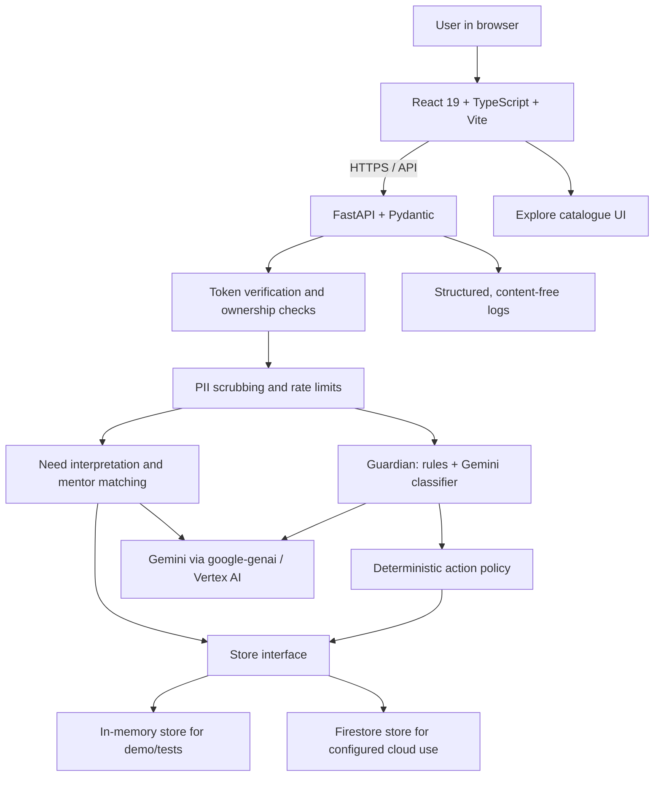

# UNSOLD

### Advice without an agenda.
**Advice from people with nothing to sell. Anonymous human guidance, protected by AI.**

UNSOLD helps people think through difficult decisions without turning their uncertainty into a sales opportunity. A person describes a situation, sees how the system understood it, compares relevant mentor profiles, and can take a conversation into a moderated session. The Guardian looks for promotion and attempts to move the conversation off-platform; after a session, the user can keep an editable summary and concrete next steps.

The core promise is simple: **make independent guidance easier to access—and make hidden commercial pressure easier to spot.**

> **Prototype status (18 October 2026):** the local Gemini structured-call check succeeded, and the live Guardian path was verified locally. The product has a tested demo experience with synthetic mentors and simulated mentor replies. The Cloud Run deployment has not yet been verified end to end. See [Current status and limitations](#current-status-and-limitations) before interpreting any feature as production-ready.

---

## The problem

A job offer, career change, workplace conflict, startup decision, or expensive training choice can be hard to navigate alone. Useful advice may be inaccessible, while the people or services offering advice can also have something to sell.

That creates three problems:

1. **Access:** not everyone can afford coaching or has a trusted, experienced person to ask.
2. **Conflicts of interest:** advice can quietly become promotion for a course, clinic, coaching package, product, or referral.
3. **Trust:** users may not know why a recommendation was made, what information is exposed, or whether a warning system is actually working.

UNSOLD approaches this as a product-design problem—not simply a chatbot prompt. It combines pseudonymous interactions, explainable matching, a dedicated anti-promotion Guardian, deterministic enforcement rules, and an explicit record of what the system did.

## The solution

UNSOLD is a free, pseudonymous guidance experience built around five product principles:

- **People before prompts.** AI helps structure a problem and find relevant people; it does not pretend to be the mentor.
- **No commercial marketplace.** There are no paid mentor rankings, ads, affiliate links, or paid guidance in the product design.
- **Explainable matches.** A match includes a reason grounded in the mentor's public profile. The system can say that no strong match was found instead of manufacturing confidence.
- **A Guardian with enforceable rules.** Gemini may classify a message, but deterministic application code selects the final action.
- **Honest AI provenance.** A result is labelled `gemini`, `fallback`, `keyword`, or `rules` according to the path that actually produced it.

### The user journey

1. **Describe a situation.** The user explains what they are working through and can indicate whether money is involved.
2. **Scrub identifying details.** The backend applies deterministic PII scrubbing before storing free text or passing it to a model.
3. **Review the interpretation.** The system structures the need into a summary, goal, domain, risk signals, language, and preferred mentor traits. The user can inspect the interpretation rather than silently accept a guess.
4. **Compare up to three matches.** The system ranks mentor profiles using transparent fit signals and provides grounded explanations, watch-outs, and starter questions.
5. **Talk with the Guardian in the loop.** Session messages are scrubbed and screened. Promotional content may be allowed, warned on, or blocked and redacted according to a code-owned policy.
6. **Leave with something actionable.** The session flow supports mutual-consent reveal, an editable summary, next steps, feedback, and the Friend Test for decisions involving spending.

The current prototype uses **synthetic mentors and simulated mentor replies**, clearly labelled in the interface. This lets reviewers test the full product flow without mistaking demo personas for real people.

## What makes UNSOLD different

| Design choice | Why it matters |
|---|---|
| Pitch-free Guardian | Looks for direct promotion, contact solicitation, urgency/fear, soft steering, and affiliate/referral behaviour. |
| Deterministic enforcement | Model output does not directly decide whether a message is allowed, warned on, or redacted. |
| Friend Test | For money-related decisions, surfaces whether the mentor cautioned against spending, stayed neutral, or pushed spending. |
| Explainable mentor fit | Uses public-card facts and the user's interpreted need; does not invent employers, history, credentials, or contact details. |
| Mutual-consent reveal | Contact information is not exposed just because one side asks to reveal. Both sides must consent in the designed state machine. |
| Honest fallback behaviour | If Gemini is not configured or a call fails, deterministic behaviour remains available and the result is labelled honestly. |
| Privacy-aware defaults | User-written free text is scrubbed before persistence and model calls; logs contain event metadata, not message content. |

## Product tour

The most useful way to experience the prototype is to follow one complete scenario:

1. Open the UNSOLD home page and choose a sample situation.
2. Review the interpretation and the top mentor matches. Check the explanation and any cross-domain caveats.
3. Start a session and submit ordinary advice plus an intentionally promotional test message.
4. Observe the Guardian decision, warning/redaction, and Friend Test where relevant.
5. End the session, inspect and edit the summary, and submit feedback.
6. Open **Trust** to test the Guardian playground and inspect its actual source label and the evaluation caveats.
7. Open **Explore** to see the supporting catalogue of activities and the explicit relationships between them.

The mentor corpus contains **35 synthetic mentor cards** and **10 synthetic sample situations**. The supporting Explore catalogue has **88 sample entries** and **151 explicit relationship records**. These are prototype assets, not evidence of a live volunteer network or real user outcomes.

---

## Run UNSOLD locally

### Prerequisites

- Python **3.12**
- Node.js 22 (the deployment Dockerfile uses `node:22-slim`)
- npm
- Git
- Optional, for live Gemini: Google Cloud CLI, an enabled Google Cloud project with billing configured, and Application Default Credentials (ADC)

The backend and frontend can run locally. Google Cloud credentials are **not** required for the deterministic demo path; real Gemini calls need the project configuration described below.

### 1. Clone and open the repository

```bash
git clone https://github.com/Nanakjoth/UnSold.git
cd UnSold
```

If you already have the repository, open a terminal at its root—the directory containing `server/`, `web/`, `scripts/`, `.env.example`, and `cloudbuild.yaml`.

### 2. Create the Python environment

**Windows PowerShell** (run from the repository root):

```powershell
py -3.12 -m venv server\.venv
.\server\.venv\Scripts\python.exe -m pip install --upgrade pip
.\server\.venv\Scripts\python.exe -m pip install -r .\server\requirements.txt
```

**macOS/Linux** (run from the repository root):

```bash
python3.12 -m venv server/.venv
server/.venv/bin/python -m pip install --upgrade pip
server/.venv/bin/python -m pip install -r server/requirements.txt
```

If the virtual environment already exists, reuse it rather than creating it again.

### 3. Configure environment variables

Create a local `.env` from the template. Do not replace an existing `.env` blindly, because it may already contain your local settings.

**Windows PowerShell:**

```powershell
if (-not (Test-Path .env)) {
    Copy-Item .env.example .env
}
notepad .env
```

**macOS/Linux:**

```bash
test -f .env || cp .env.example .env
$EDITOR .env
```

For the local demo, keep `APP_MODE=demo`. To enable Gemini, configure the actual project and model settings in the root `.env`:

```dotenv
APP_MODE=demo
GOOGLE_CLOUD_PROJECT=YOUR_GOOGLE_CLOUD_PROJECT_ID
GOOGLE_CLOUD_LOCATION=global
GEMINI_MODEL=gemini-3.5-flash-lite
GEMINI_MODEL_STRONG=
EMBED_MODEL=gemini-embedding-001
EMBED_DIM=768
FIRESTORE_DB=(default)
```

These model settings reflect the local configuration that was successfully used for a **structured Guardian call** on 18 October 2026. Confirm current model availability and dimension support for your own project and code before changing them. The embedding output dimension requested by the application must match any vector index using those embeddings.

Keep `.env` private. **Never commit `.env`, access tokens, credentials, or service-account key files.** `.env.example` is the safe template for version control.

### 4. Authenticate for real Gemini calls (optional)

Install the [Google Cloud CLI](https://cloud.google.com/sdk/docs/install), select your project, and authenticate:

```powershell
gcloud auth login
gcloud config set project YOUR_GOOGLE_CLOUD_PROJECT_ID
gcloud auth application-default login
```

For the current `.env` project, replace the placeholder with your actual project ID. Enable the Vertex AI API in that project and make sure your identity is permitted to call the selected model. Do not download or commit a service-account JSON key for local development.

### 5. Verify Gemini before running the UI (optional, recommended)

Run from the **repository root** so the application reads the root `.env`.

**Windows PowerShell:**

```powershell
.\server\.venv\Scripts\python.exe .\scripts\check_gemini.py
```

**macOS/Linux:**

```bash
server/.venv/bin/python scripts/check_gemini.py
```

Success is reported as:

```text
RESULT: gemini
```

`RESULT: fallback` means the application safely used its fallback path; it is not a successful live-model test. The check makes one structured call through the Guardian prompt/schema path. A successful Guardian check does not, by itself, prove that every other AI-enabled feature is using Gemini in the running application.

### 6. Start the backend

**Important:** run this from the repository root. The root `.env` is resolved from the current working directory; starting from `server/` can cause the root configuration not to be loaded.

**Windows PowerShell:**

```powershell
.\server\.venv\Scripts\python.exe -m uvicorn app.main:app --app-dir server --reload --port 8080
```

**macOS/Linux:**

```bash
server/.venv/bin/python -m uvicorn app.main:app --app-dir server --reload --port 8080
```

Keep this terminal open. Confirm the health endpoint responds:

- `http://localhost:8080/healthz`

Expected response:

```json
{"ok": true}
```

### 7. Start the frontend

Open a **second terminal** at the repository root.

```bash
cd web
npm install
npm run dev
```

Open **http://localhost:5173**. Vite proxies API calls to the backend on port `8080`.

If the page opens but API calls return unexpected 404 responses, check whether an old backend is already occupying port `8080`. Stop the stale process or update the dev proxy to target the correct backend.

### 8. Run the tests

**Backend tests — Windows PowerShell:**

```powershell
cd server
.\.venv\Scripts\python.exe -m pytest
```

**Backend tests — macOS/Linux:**

```bash
cd server
.venv/bin/python -m pytest
```

The project documentation records **206 passing backend tests** in its last documented test run. Re-run the suite in your current checkout and environment to confirm the current result.

From the repository root, the Guardian evaluation runner is:

```powershell
.\server\.venv\Scripts\python.exe .\scripts\run_eval.py
```

The evaluation data and runner are described under [AI evaluation](#ai-evaluation-and-evidence).

---

## Architecture

The prototype uses one repository with a React single-page application and a FastAPI backend. They can run separately during development and are designed to be packaged into one Cloud Run service for deployment.



### Core implementation decisions

- **Store abstraction:** advice, sessions, feedback, and catalogue operations use a common store interface, with an in-memory implementation for demo/tests and a Firestore implementation for configured cloud deployments.
- **Gemini client seam:** model calls are centralized in `server/app/gemini.py`. Structured responses are parsed and validated against Pydantic schemas. The client reports the actual source and falls back deterministically when the model is unavailable or the response cannot be used.
- **Scrub before model/storage:** free text passes through `server/app/scrub.py` before persistence and before any model call.
- **Code owns enforcement:** the Guardian classifier supplies evidence such as category and severity; deterministic code maps severity to `ALLOW`, `WARN`, or `BLOCK_AND_REDACT`.
- **Owner-scoped access:** protected endpoints derive user identity from a verified token, not from a caller-controlled user ID. The app API is the client’s data access boundary; the browser does not connect directly to Firestore.
- **Content-free observability:** structured event logs record operational metadata and outcome categories, never prompts or message text.

### Technology stack

| Layer | Technology | Responsibility |
|---|---|---|
| Frontend | React 19, TypeScript, Vite 6, Tailwind CSS v4, React Router | Responsive user experience |
| Backend | Python 3.12, FastAPI, Pydantic v2 | API, schemas, orchestration, validation |
| Generative AI | Google Gemini through `google-genai` in Vertex AI mode | Structured interpretation/classification and supported generation paths |
| Matching | Transparent weighted fit scoring; optional Gemini re-ranking path | Grounded mentor recommendations |
| Persistence | In-memory store; Firestore implementation for cloud configuration | Data access through a common interface |
| Identity | HMAC-signed demo tokens; Firebase ID-token verification in production backend | Pseudonymous identity and API authorization |
| Safety/privacy | Deterministic PII scrubber, Guardian rules, rate limiting | Reduce PII exposure and enforce safety policy |
| Hosting (target) | Google Cloud Run | Serve API and built frontend from one deployment |
| Observability | Structured JSON logs; Cloud Logging when deployed | Diagnose errors without recording user-authored content |

### Repository map

```text
.
├── server/
│   ├── app/
│   │   ├── main.py                 # App setup, API registration, SPA serving
│   │   ├── config.py               # Environment-based configuration
│   │   ├── models.py               # Pydantic request/response models
│   │   ├── store.py                # In-memory and Firestore store interface
│   │   ├── auth.py                 # Demo/production token verification
│   │   ├── scrub.py                # PII scrubbing
│   │   ├── matching.py             # Need interpretation and matching
│   │   ├── guardian.py              # Anti-promotion classifier and action policy
│   │   ├── gemini.py                # Google Gen AI client and honest fallbacks
│   │   ├── simulator.py             # Clearly labelled synthetic mentor replies
│   │   ├── evaluation.py            # Guardian evaluation calculations
│   │   ├── mentor_corpus.py         # Synthetic mentor corpus
│   │   ├── sample_scenarios.py      # Synthetic example needs
│   │   ├── catalogue.py             # Supporting discovery catalogue
│   │   └── routes/                  # API endpoints by feature
│   └── tests/                       # Backend tests
├── web/
│   └── src/
│       ├── pages/                   # Advice, Sessions, Trust, Explore, Profile, etc.
│       ├── components/              # Match cards, Guardian playground, app shell, etc.
│       ├── services/                # Frontend API clients
│       └── types/                   # TypeScript API contracts
├── scripts/
│   ├── check_gemini.py              # Real structured Gemini connectivity check
│   ├── run_eval.py                 # Offline Guardian evaluation runner
│   └── check_scenarios.py          # Sample match verification
├── eval/
│   ├── gold_set.jsonl               # 80-message labelled test corpus
│   └── last_run.json                # Last saved offline evaluation output
├── docs/
│   ├── PROJECT_EXPLAINED.md
│   ├── ARCHITECTURE.md
│   ├── PRIVACY_AND_SAFETY.md
│   ├── AI_EVALUATION.md
│   ├── CONFIGURE_AI.md
│   ├── DEPLOY.md
│   └── DECISIONS.md
├── .env.example
├── Dockerfile
└── cloudbuild.yaml
```

File names in this map describe the documented repository layout; consult the actual checkout if it differs.

---

## AI design: intelligence with guardrails

### 1. Need interpretation

The application converts a scrubbed free-text need into a structured intent, including a concise summary, goal type, relevant domains, language, money involvement, distress signals, and preferred mentor traits. Where a live Gemini path is enabled and succeeds, the result is labelled `gemini`; deterministic interpretation is labelled `fallback`.

The interpretation is inspectable so the user can correct a misunderstanding before relying on the matches.

### 2. Explainable matching

Mentor fit is transparent rather than a popularity score:

| Signal | Weight |
|---|---:|
| Topic relevance | 0.40 |
| Domain overlap | 0.34 |
| Goal / trait fit | 0.16 |
| Shared language | 0.10 |

The matcher returns up to three candidates. Explanations are restricted to the public mentor card and the interpreted need. If the fit is too weak, the system can return `no_strong_match` rather than overstate confidence. The implementation uses weighted deterministic matching; Gemini re-ranking is an optional path whose source must be reported honestly.

### 3. The Guardian

Every session message follows a defined pipeline:

```text
message
  → deterministic PII scrub
  → fast rule checks
  → Gemini classifier when configured (otherwise labelled fallback)
  → deterministic policy
  → store scrubbed content and recipient-facing display text
```

The Guardian looks for:
- Direct promotion of a paid product or service
- Requests to move a conversation off-platform or shared contact details
- Urgency and fear-based pressure
- Soft steering toward a paid provider
- Affiliate and referral behaviour

The action policy is deliberately not delegated to the model:

| Final severity | Action | Intended result |
|---|---|---|
| 0–1 | `ALLOW` | Deliver the message; log the decision category |
| 2 | `WARN` | Deliver with a promotion warning |
| 3 | `BLOCK_AND_REDACT` | Replace the recipient-facing message with a removal notice and apply a strike |

Three strikes end a session in the documented policy. The classifier can be wrong; this is a safety layer, not a guarantee of perfect detection.

### 4. Friend Test and follow-through

For sessions involving a money decision, the Friend Test surfaces whether advice cautioned against spending, remained neutral, or pushed spending. After a session, the user receives an editable summary with key points, practical action items, caveats, and relevant catalogue items to explore. The system does not claim that feedback retrains Gemini; feedback updates application-level signals and records disagreements for human review.

---

## AI evaluation and evidence

The offline Guardian evaluation uses `eval/gold_set.jsonl`, an 80-message corpus:

- 40 clean messages, including 20 hard negatives that mention things such as courses or certifications without actually pitching.
- 40 promotional messages across direct promotion, contact solicitation, urgency/fear, soft steering, and affiliate/referral categories.
- A fixed development/test split to reduce tuning leakage.
- Precision, recall, F1, per-category recall, hard-negative false-positive rate, and a confusion matrix.

**Critical caveat:** the gold-set labels are machine-generated and still marked `unreviewed`. Until they receive the documented human review, these values describe current rule behaviour on that set; they must not be presented as validated real-world model accuracy. The live Guardian test and the offline rule evaluation are different kinds of evidence and should be reported separately.

Recommended next evaluation work:
1. Have reviewers independently label fresh, human-written clean and promotional messages.
2. Freeze the test set before adjusting rules or prompts.
3. Measure the live Gemini classifier and deterministic fallback separately.
4. Report sample sizes, per-language coverage, false positives, false negatives, latency, and fallback rates.
5. Keep failures and borderline cases visible rather than hiding them behind a single accuracy number.

---

## Privacy, safety, and responsible use

- **Pseudonymous by design:** public cards use generated pseudonyms and limited role/domain bands. The prototype's mentor cards and mentor sessions are synthetic.
- **PII scrubbing first:** free text is scrubbed before storage and before any model call. The deterministic scrubber reduces exposure but does not promise perfect identification of every name or sensitive detail.
- **No direct browser-to-Firestore access:** the browser calls the API; backend authorization and ownership checks protect user records.
- **No message text in logs:** structured logs record event types, IDs/counts where appropriate, categories, status, model outcome, and timing—not prompts or message content.
- **Rate limiting:** API rate limits return `429` with `Retry-After` where applicable.
- **Deletion:** the documented delete flow cascades across the caller's account, needs, sessions, messages, feedback, and saved/discovery records and reports deletion counts.
- **Distress handling:** distress signals show a support note; UNSOLD is not a clinical, crisis, therapy, or professional-advice service.
- **Reveal requires consent:** the designed reveal state machine requires both sides to consent. In this prototype, the mentor's side is simulated and explicitly labelled.

Anonymity does not mean invisibility from all infrastructure metadata. Cloud operators and providers may process technical metadata such as IP addresses. Do not submit sensitive personal information to this prototype.

See [`docs/PRIVACY_AND_SAFETY.md`](docs/PRIVACY_AND_SAFETY.md) for the operative details.

---

## Current status and limitations

### Implemented and documented

- Advice front door and structured need intake
- 35 synthetic mentor cards and 10 sample situations
- Transparent mentor-fit scoring and grounded explanations
- Session flow, Guardian screening, Friend Test, and labelled mentor simulation
- Consent-state flow for reveal, editable session summary, next steps, and feedback
- 80-message offline Guardian evaluation harness
- Trust page with anonymous Guardian playground and public aggregate statistics
- Procedural neural-network animation behind the home hero (canvas, no extra dependencies, static frame under `prefers-reduced-motion`)
- Supporting Explore catalogue with 88 sample entries and 151 explicit relationships
- Local live Gemini connectivity check: **verified on 18 October 2026** using the project's structured Guardian call

### Not yet production-complete

- **Cloud Run:** deployment has not yet been verified end to end. The deployment runbook and Cloud Build configuration are present, but a successful local Gemini request is not proof of a working deployed service.
- **Firebase browser sign-in:** production token verification exists in the backend, but the React client still needs the Firebase anonymous-auth integration for authenticated production flows.
- **Real mentors:** real volunteer onboarding, mentor verification, authenticated mentor participation, and real two-sided consent are not implemented; mentor-side actions are simulated.
- **Evaluation labels:** all 80 gold-set labels remain unreviewed; reported values are not validated accuracy claims.
- **Cloud data persistence:** Firestore support exists, but configure and verify it in the target project before claiming production persistence. Demo mode uses an in-memory store and must be treated as prototype data.
- **Optional Google integrations:** DLP-based extra redaction, App Check, BigQuery/Looker Studio analytics, a staffed trust-and-safety review console, and a multi-agent ADK matcher remain planned rather than core completed functionality.
- **Not professional advice:** UNSOLD is not therapy, crisis support, medical/legal/financial advice, recruitment, or a paid coaching marketplace.

The prototype is designed to demonstrate the product's central idea and technical approach; it is not a claim that a live, verified volunteer network already exists.

---

## Deploying to Google Cloud

The target deployment is a single **Google Cloud Run** service serving the built React app and FastAPI API. Gemini calls run through Vertex AI using the Cloud Run runtime identity. Firestore is the planned persistent store for the configured cloud path.

**Use [`docs/DEPLOY.md`](docs/DEPLOY.md) as the canonical deployment runbook.** It defines the one-time resources, least-privilege runtime service account, Firestore database, Artifact Registry, first revision with no traffic, verification, promotion, rollback, and troubleshooting.

Before deploying:

1. Confirm the target Google Cloud project has billing enabled and create a budget alert.
2. Verify that the selected model IDs and location are currently available.
3. Enable the APIs required by the runbook.
4. Create the dedicated runtime service account with least-privilege roles—do not grant broad Owner/Editor access.
5. Run `scripts/check_gemini.py` locally and confirm `RESULT: gemini`.
6. Keep all secrets and `.env` values out of the repository.

The repository's Cloud Build configuration intentionally requires explicit model substitutions. After completing the one-time setup in `docs/DEPLOY.md`, the documented submission pattern is:

```bash
gcloud builds submit --config cloudbuild.yaml . \
  --substitutions=_GEMINI_MODEL=gemini-3.5-flash-lite,_EMBED_MODEL=gemini-embedding-001,_EMBED_DIM=768,_APP_MODE=demo
```

Use the substitutions and region expected by the actual `cloudbuild.yaml` and runbook in the checked-out repository. The example chooses `demo` mode for a clearly labelled, synthetic-data prototype. Demo mode is not a production identity/persistence configuration. Review the runbook's verification steps before sending traffic to a new revision.

After deployment, test `/healthz`, the public Guardian playground, representative clean and promotional inputs, browser behaviour, Cloud Run logs, and the source labels returned by the live path. Do not claim the deployment works until these checks have passed against the deployed URL.

---

## Google Cloud AI Builder Cup alignment

UNSOLD's proposed alignment is **Sustainability & Social Impact**: it targets access to useful guidance regardless of budget and attempts to reduce exposure to predatory upselling. The official theme and the category selected in the submission dashboard must match; the team should make that selection explicitly rather than assume this README sets it.

The event's published requirements call for a functional prototype deployed on Google Cloud using Google AI (for example, Gemini/Gemma) or an eligible agent platform. The official terms additionally list a live URL, public GitHub repository, a proposal/architecture deck, and a public video demonstration. All submission materials must be in English.

Official links:
- [AI Builder Cup overview and timeline](https://aibuildercup.com/)
- [Themes, requirements, and judging criteria](https://aibuildercup.com/themes.html)
- [Official Terms & Conditions](https://docs.google.com/document/d/e/2PACX-1vRm7ChZ6Ij9fG7uFDkxzUMpwgVeBmnQ6cMDnAIEEX84AiLBOOQ9cYbl3S5OzFBbcVb8TF55s-eVpiXb/pub)

The currently published page lists **18 October 2026** as the prototype deadline; check the team dashboard for its precise cutoff and any updated instructions. The public theme page says a 3-minute video while the terms specify 3–4 minutes—follow the live submission form/dashboard if it resolves that discrepancy. The terms also require fresh work produced within the official hackathon timeline and prohibit use of third-party materials without sufficient rights; the team is responsible for ensuring its submission complies.

The published judging weights are:
- **Technical Merit & Gen AI Implementation — 40%**
- **Problem Alignment & Impact — 25%**
- **Innovation & Creativity — 25%**
- **User Experience & Solution Design — 10%**

The product should stand on its working flow, traceable AI use, privacy design, clear limitations, and measured evidence—not on claims that are not yet verified.

---

## Project documentation

- [`docs/PROJECT_EXPLAINED.md`](docs/PROJECT_EXPLAINED.md) — full product walkthrough
- [`docs/ARCHITECTURE.md`](docs/ARCHITECTURE.md) — code structure, data model, and request flow
- [`docs/PRIVACY_AND_SAFETY.md`](docs/PRIVACY_AND_SAFETY.md) — privacy, retention, deletion, and safety limitations
- [`docs/AI_EVALUATION.md`](docs/AI_EVALUATION.md) — evaluation method and caveats
- [`docs/CONFIGURE_AI.md`](docs/CONFIGURE_AI.md) — configure and test Gemini locally
- [`docs/DEPLOY.md`](docs/DEPLOY.md) — Google Cloud deployment runbook
- [`docs/DECISIONS.md`](docs/DECISIONS.md) — key architectural/product decisions and history

## A final principle

**UNSOLD does not ask users to trust AI blindly. It shows how the system interpreted their need, explains why it surfaced a match, applies explicit rules to promotion risks, and is honest when a model or safeguard falls back.**

That is the product promise: useful guidance without an agenda—and a system designed to make its own behaviour inspectable.
